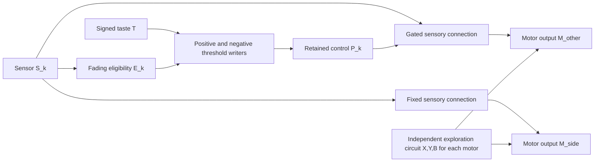

# D180 — Catalogue-native starting brain, design v1

Status: proposed circuit and frozen initial parameters, not a demonstrated learner. The user chose this
starting point on 2026-11-20. Execution is governed solely by
[the work order](../WORK_ORDER_2026-11-20_catalogue_brain.md). That file owns experiments, budgets and gates;
[design.py](design.py) owns all initial graph parameters. No historical neuron is instantiated.

## Purpose and innate assumptions

Test whether a small assembly of the existing catalogue can explore, use informed sensory settings,
and acquire useful settings through taste. This is a hand-designed starting point for later local repair,
not a proposed general learning algorithm or an autonomous architecture search.

The innate wiring hypothesis is the historical two-path arrangement: each sensor drives one randomly
chosen motor through a fixed connection and the other through a retained control. Large control values
make sensory activity influence both motors; small values favour one. This is an explicit prior, not
knowledge of either colour or the realised motor/body mapping. We do not claim that it is optimal or
that a stronger connection necessarily improves food collection. The informed and reversed controls
specifically test that premise. Sensor-side choices are independent coin tosses at birth, including
both choosing the same side. Never select wiring by its resulting behaviour.

## Circuit

15 nodes (four retained), 22 controlled connections; zero implicit filter states. These are graph counts,
not transistor counts. Static `minimal.spice.count` accounting reports 770 transistors, 97 resistors,
27 capacitors, 6 diodes and 88 sources; this is model accounting with the known memory-supply limits,
not a measured fabrication cost. The two extra retained states are oscillator bias controls, not learned valence.

The last two arrows denote one exploration circuit per motor, not a shared oscillator. `design.py`
is the exact graph; render all named nodes/connections in the execution schematic, including oscillator
feedback and writer signs, rather than treating these boxes as free components.

- **S0, S1, T:** leaky input nodes. The existing interface injects `PULSES * circuit.unit()` for `PULSE`
  seconds; taste changes its sign. These are the authorised technology-dependent currents, not altered
  body pulses. All pulse times remain those supplied by `Life`.
- **E0, E1:** each integrates its own thresholded sensory voltage and decays. Both may be active;
  there is deliberately no hidden winner or claim that the last sensor must be responsible for taste.
- **P0, P1:** retained controls initially `V_TYP/2`. Positive/negative taste writers use opposite slopes
  and offsets, gated by their own E. Their explicit thresholds plus the existing memory-driver deadband
  must suppress false writing. No computed weight update or assignment after birth is allowed.
- **X_k,Y_k,B_k:** one independent D162-style adaptive oscillator per motor. Fast positive feedback,
  delayed negative feedback through an explicit leaky node, and retained local bias correction.
  Same topology and starting coefficients as the bench witness, new whole-graph component draws;
  its historical reliability does not transfer automatically. B adapts in every arm unless specifically
  removed in an oscillator bench control. This is supplied homeostasis, not newly demonstrated repair.
- **M0,M1:** leaky output nodes with negative resting bias, driven by thresholded exploration and
  sensory currents. No excitable-neuron macro, external reset, software pulse scheduler or Poisson motor
  source. The existing engine counts an upward crossing through zero, and re-arms below `-V_TYP`.
  The body receives exactly those events. A positive plateau is not a stream of spikes.

An exploration circuit has no incoming sensory, taste or motor connection: its source trajectory is
identical across paired arms when its parameters, initial state and noise are identical. Its realised
motor events need not be identical: overlap with sensory input can mask a crossing. That interaction
is the first assembly risk to test, not something to remove in software.

## Equations and initialization

Each dynamic node obeys the existing engine's noisy current integration:
`C dV/dt = bias - V/R + sum(connection currents) + body current + substrate noise`.
An element uses the engine's tanh or sigmoid, rail fading, and optional gate
`clip(V_gate/V_TYP, 0, 1)`; its parameters are in design.py. Retained nodes have no leak/resting
noise but retain the established writer threshold and shot noise. No engine equation changes.

Build in exactly the listed node/edge order, with stable names. Whole-graph circuit seed is
`world_seed + 1000003`, `streams=True`, `substrate='silicon'`, `volt=V_TYP`, `on_chip=True`.
Separate initial-state RNG: `default_rng([world_seed,180,1])`; dynamic and B nodes start independently
uniform in `[-V_TYP/4,V_TYP/4]`; P starts neutral; M starts at `-1.5*V_TYP`. Supply explicit starts to
all nodes so `_ready` does not silently supply deterministic settling. Wiring RNG is
`default_rng([world_seed,180,2])`, two independent integer draws in [0,2). No state depends on world phase,
colour meaning or motor meaning. Informed controls alone receive birth-time P assignments in the harness.

All bounds are supply rails, not interior numerical clamps. P may go below zero or above V_TYP;
its readout then saturates but the state persists. Record that possible windup. No clipping P into
[0,V_TYP] for convenience: an interior clamp would be another part and design revision.

## Initial engineering estimates, not simulated results

At nominal 5 pF input capacitance and 10 ms decay, an authorised 0.9 nA, 2.5 ms pulse peaks at about
0.398 V (`I*R*(1-exp(-PULSE/(R*C)))`). A 0.15 V threshold has substantial nominal amplitude margin;
30 mV scale offsets and pulse accumulation still require measurement. Passive thermal input noise is
about 29 microvolts (`sqrt(kBT/C)`), much smaller than mismatch. Neither estimate certifies quiet writes.

A 10 pF motor output with 5 ms decay rests nominally near -0.45 V before rail fading. One full
1.8 nA source nominally targets +0.45 V. Starting at rest, zero crossing takes about 3.5 ms; after
source removal, re-arming from +0.45 V takes about 9 ms. A sensor pulse's above-threshold tail can
therefore drive an event; sustained or overlapping inputs can instead prevent re-arming. Explore
sources may have long duty cycles. These estimates select the paired-pulse/phase tests; they do not
require one motor event for every body pulse or tune an in-life rule to the body's pulse length.

The initial taste writers are 300 pA, with a nominal ungated 60 V/s memory slew. Eligibility usually
opens only partway, and memory deadband/threshold duration reduce charge. A short taste can produce a
substantial update, so single-taste overshoot, wrong-trace writes and long-lived saturation must be
measured. This deliberately reuses a simple associative rule; it is not a policy-gradient derivation.

Nominal values pass the static C/R/current/per-element slew/self-loop checks. Aggregate slew, realised
mismatch, operating range, transistor counts and behaviour are execution obligations. No SPICE claim.

## Research choice and alternatives

Read Arthur & Boahen (2011), full-text sections II–III A of
[Silicon-Neuron Design](https://pmc.ncbi.nlm.nih.gov/articles/PMC3100558/): choose integration, oscillation
and recovery from required dynamics. That supports separating a rhythm source from an event readout;
it does not guarantee this assembly or recommend a new primitive. An excitable relay is an alternative,
but would restart the unresolved neuron operating-region work. Here passive output recovery is inspectable.

Read Florian (2007), abstract, introduction, section 3 equations (3.1–3.3), and the delayed-reward
discussion around Figure 8 of
[Reinforcement Learning Through Modulation of STDP](https://www.florian.io/papers/2007_Florian_Modulated_STDP.pdf).
Its delayed-reward mechanism retains pre/post activity relationships. Our sensory-only trace omits that
relationship and the stochastic-policy assumptions of its analytical derivation. It supplies precedent
for temporal credit storage, not a guarantee for this rule. A pre/post eligibility mechanism or a
reward-baseline rule is a later alternative if this simpler association fails; neither is silently added.
Frémaux–Gerstner's review was opened for orientation, not used as a new primary result.

Project-specific question: do these explicit, costed parts compose into useful robot action and learning,
and which local shortfall remains? Reuse, autonomous component selection and scaling remain future claims.
