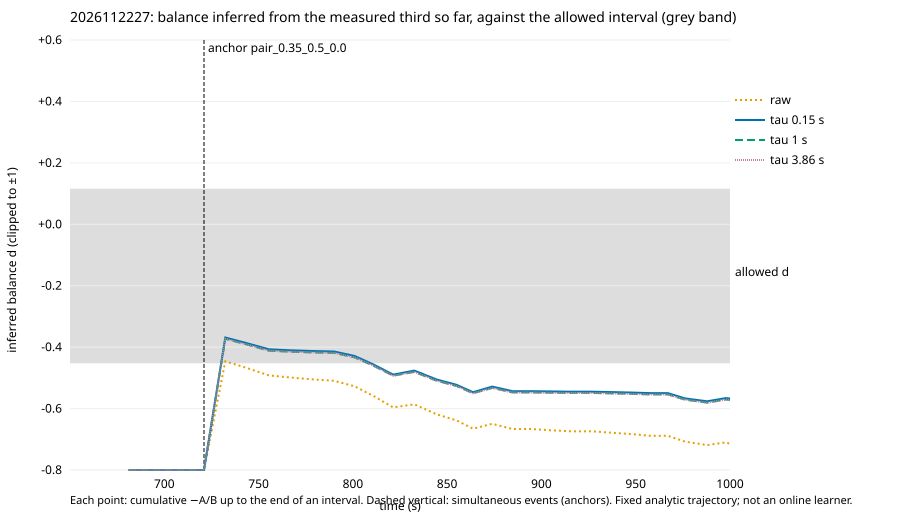

# Task C — attributing D163's calibration to recorded events

**Validity.** The 40 D163 histories were regenerated (`make_long_stream(row,10,2)`; every event list identical to
D163's) and replayed with D163's analytic observer (`stream_trajectory` at 0.5 ms, the positive-path decomposition
with only `elements[0][6]=0`). Final-third A/B integrals reproduce D163 with maximum absolute error **0.0 V s**,
knob error **0.0**. The interval partition (boundaries at each event's `first_s`, split exactly with
`partition_integrals`) sums back to the full-window integrals within **9.1e-15 V s** (limit 1e-9). Checks:
`attribution_checks.json`. Elapsed 437 s.

This is temporal accounting on fixed trajectories: each interval holds whatever the observer integrated between one
event start and the next, including tails of earlier events. Leave-one-out and anchor-only sums are arithmetic on
those fixed contributions, **not causal ablations** (the trajectory and baseline state are not re-run without the event).

## What it shows

1. **Anchors carry the identification.** Using only the intervals that begin with a simultaneous pair, the
   baseline references reach **39/40** (every draw except the infeasible 2026112215); the full final third reaches
   38/40; the other intervals alone reach only 10–12/40, with settings scattered from −1 to +0.8. Raw output: 29/40
   anchors-only, 28/40 all, 14/40 others-only. One simultaneous interval contributes B ≈ 0.009 V s, about ten times a
   near-order interval (≈ 0.0008 V s), so anchors dominate whenever there are several.
2. **2026112227 fails by contamination, not by an unrepresentative anchor.** Its single anchor (event 73,
   simultaneous A .35 V / B .5 V at 721.07 s) alone gives d = −0.241 (tau .15 s; −0.245/−0.245 slower; raw −0.292),
   inside the allowed interval (−0.4525, +0.1160) and passing all 34 old cases. Adding the other 32 intervals moves it
   to −0.567 (raw −0.715), outside. This is the only draw/mode where an acceptable anchor-only setting is moved out by
   the other intervals (`attribution_summary.json`). The largest non-anchor contributions are **positive near-order
   pairs** (A then B 0.06 s apart): each adds A ≈ B (≈ 0.0008 V s), i.e. each "votes" for d ≈ −1. Under the
   generator's 80% A-before-B skew these are frequent; their correct, positive order output is read by the observer
   as imbalance. 2026112226 shows the same pull more mildly (anchors only −0.146, all −0.334, lower bound −0.355).
3. **Amplitude specificity and preceding state are not needed to explain 2227.** The same amplitude case observed
   in isolation (D156 informed baseline reference) gives d = −0.245, and its zero-output branch setting −0.195; both
   pass all 34 cases, as does D155's four-simultaneous-case reference (−0.165). The in-history anchor (−0.241) agrees
   with the isolated case (−0.245) to 0.004, so the state preceding the anchor shifts it little. What remains
   confounded: the anchor interval itself includes ~11 s of following quiet time and any tail it carries, and the
   "contamination" is attribution by time interval, not by causal removal of the near-pair events.
4. **2026112215** (3 anchors) has anchors-only d ≈ +0.049 (tau .15 s) and all-window +0.047: the evidence agrees
   with itself, but no constant setting exists (Task B).
5. **2026112200** (fixed comparison, 5 anchors): anchors-only +0.122, all +0.058, both pass; contamination present
   but diluted.

Fallback d = 0 (no calibration, labelled comparator) passes 34/40 in every mode.

`cumulative_d_2227.svg`: cumulative −A/B from the start of the measured third for each mode (colour plus line style
plus legend label), against the allowed interval (grey band); dashed vertical line = the anchor.

## Files
- `event_contributions.jsonl` — every interval of every seed: event id, case, amplitudes, delay, start/end, duration, W, A and B per mode.
- `aggregate_settings.jsonl` — 1984 settings: all, anchors only, others only, leave-one-anchor-out, prefixes to each anchor, d=0 fallback; each scored on 34 cases.
- `anchor_cases.json` — 2227, 2215, 2200 in detail, including isolated-case comparisons.
- `seed_table.md` — all 40 seeds × 4 modes.
